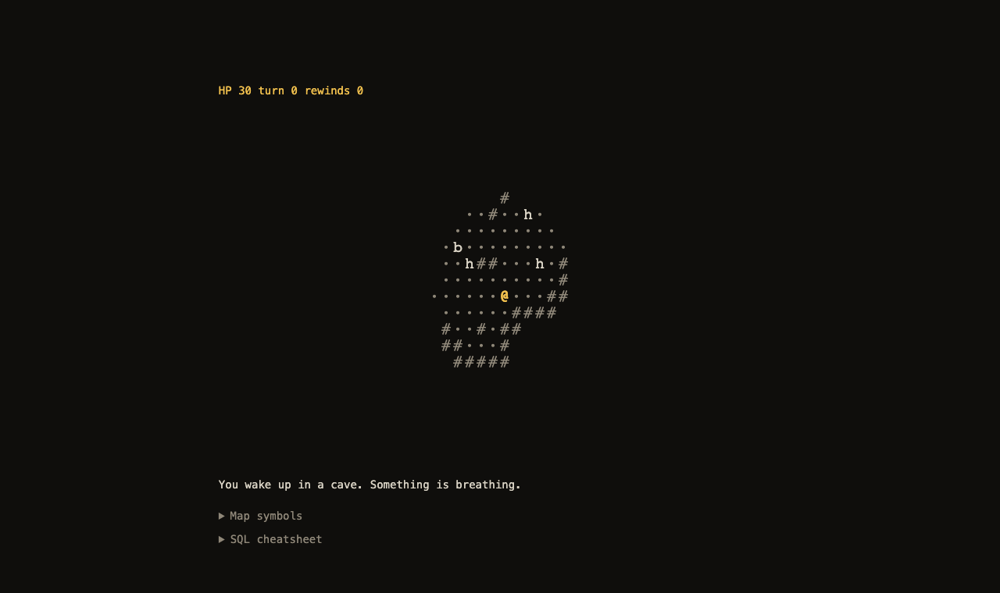
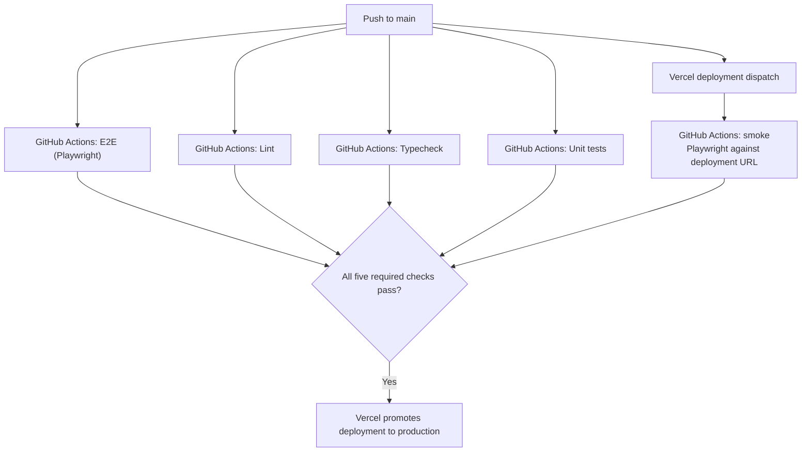

# pg-dungeon

A small cave crawler where PostgreSQL is the game engine. I wanted to exercise writing sql faster and to experiment with advanced PG features, so I decided to make it into a game. The game runs on the browser using [PGlite](https://electric-sql.com/product/pglite).

All the game rules and entities live in SQL, so be ready to explore what's available using \dn, \df etc. Typescript is here to init the db, manage the console and render the game.

RLS protects fog of war, and foreign keys ensure creatures stay on walkable tiles.



```sh
npm install
npm run dev
npm test
npm run lint
npm run format
npm run format:check
```

`npm run format` uses Prettier for app files and `sql-formatter` for PostgreSQL files. Staged SQL files are formatted automatically before commit.

Tests live in `test/`, split by domain. Shared database setup is in `test/support/`.

## Record a gameplay GIF

Run a short local game and save an animated GIF to `recordings/gameplay.gif`:

```sh
npm run record:gameplay
```

## Browser smoke test

Run the Playwright end-to-end tests locally with:

```sh
npx playwright install chromium
npm run smoke
```

The pre-commit hook runs these tests as well. Install Chromium once on each
development machine before committing.

## Deployment and CI/CD

GitHub runs E2E, lint, typecheck, and unit tests on pushes to `main`. Vercel
runs the smoke test against the deployment. All five checks must pass before
production.



## Production build

Type-check the TypeScript and build the static app with:

```sh
npm run build
```

The build runs the type check first and stops if it finds errors. Vite writes the production files to `dist/`. To check the production build locally, run:

```sh
npx vite preview
```

Deploy the contents of `dist/` to any static web host. The game database runs in the browser through PGlite, so no separate database server is required.

## Play through SQL

Use the console to inspect the game and choose actions. Press Enter to run a query or Alt+Enter to add a newline for a multiline query. Example queries to use in the game:

```sql
select target.id, target.kind, species.glyph, target.hp, target.x, target.y,
       point(target.x, target.y) <-> (select (creature.hero()).pos) as distance_to_player
from creature.creatures target
join creature.species species using (kind)
where target.kind <> 'hero'
  and creature.in_sight(target.x, target.y);

select id, kind, name
from item.items join item.kind using (kind)
where holder_id = (select id from creature.creatures where kind = 'hero');

select game.move(1, 0);

select game.drink_potion((
  select id from item.items
  where kind = 'healing_potion'
    and holder_id = (select id from creature.creatures where kind = 'hero')
  limit 1
));
```

Items all live in `item.items`. The player role can only see floor items within the hero's sight because of RLS. To find those items, query for unheld items:

```sql
select item.id, item.kind, kind.name, item.x, item.y
from item.items item
join item.kind kind using (kind)
where item.holder_id is null
order by item.id;
```

To find only items within pickup range (including the item ID and name), use:

```sql
select item.id, item.kind, kind.name
from item.items item
join item.kind kind using (kind)
cross join creature.hero() hero
where item.holder_id is null
  and abs(item.x - hero.x) + abs(item.y - hero.y) <= 1;
```

Use the returned ID in `select game.pick_up(ID);`. If an item is farther away, move toward its `(x, y)` coordinates one cell at a time with `game.move(dx, dy)`, using an offset such as `(1, 0)` or `(0, -1)`. `holder_id IS NULL` selects floor items. `holder_id = (select id from creature.creatures where kind = 'hero')` selects carried items.

Weapons are items in `item.items`. A sword must be used next to its target, a bow attacks one visible enemy at range, and a firebomb damages enemies around its selected target:

```sql
select game.attack(
  (select id from item.items
   where kind = 'shortbow'
     and holder_id = (select id from creature.creatures where kind = 'hero')
   limit 1),
  (select target.id from creature.creatures target
   where target.kind = 'rat'
     and creature.in_sight(target.x, target.y)
   limit 1)
);
```

## Layout

The game is split into domain schemas. Each part uses only schemas defined before it in this list.

| Schema     | File                                         | Holds                                                  |
| ---------- | -------------------------------------------- | ------------------------------------------------------ |
| `clock`    | [`01_clock.sql`](src/sql/01_clock.sql)       | Turn counter, message log, rewind counter              |
| `map`      | [`02_map.sql`](src/sql/02_map.sql)           | Map settings, cells, walls, cells seen, cave digging   |
| `creature` | [`03_creature.sql`](src/sql/03_creature.sql) | Species, bodies, sight, monster AI, combat             |
| `item`     | [`03_item.sql`](src/sql/03_item.sql)         | Item types and item entities, carried or on the floor  |
| `screen`   | [`04_screen.sql`](src/sql/04_screen.sql)     | Views the browser prints: tiles, status, messages      |
| `game`     | [`05_game.sql`](src/sql/05_game.sql)         | Game actions, new game, rewind, and player permissions |

The TypeScript side:

| File                           | Does                                                                                 |
| ------------------------------ | ------------------------------------------------------------------------------------ |
| [`db.ts`](src/db.ts)           | Boots PGlite, loads the SQL files in order, records statements for the history panel |
| [`session.ts`](src/session.ts) | Starts the game transaction, recovers failed actions, and rewinds turns              |
| [`render.ts`](src/render.ts)   | Prints the `screen` views                                                            |
| [`console/`](src/console)      | Runs player SQL, psql commands, and statement history                                |

The game uses one database transaction for its full session and relies on PostgreSQL savepoints for rewinding.

## How PostgreSQL features support game mechanics

| Mechanic         | Postgres feature                                                                                                                                                        |
| ---------------- | ----------------------------------------------------------------------------------------------------------------------------------------------------------------------- |
| Walls            | A composite foreign key from `creature.creatures (x, y, on_floor)` to `map.cell (x, y, walkable)`. Walking into rock is a `foreign_key_violation`.                      |
| Attacking        | The exclusion constraint detects collisions. `game.move` turns walking into an enemy into a hit, and `game.attack` handles weapon attacks.                              |
| Fog of war       | Row level security prevents the `player` role from reading cells or monsters outside the hero's sight.                                                                  |
| What's on screen | Views created `with (security_invoker = true)`. A plain view runs as its owner and could skip the fog.                                                                  |
| Map memory       | `map.seen`, which the fog policy also lets through. Monsters are not remembered.                                                                                        |
| Cave generation  | A drunkard's walk written as a recursive CTE, seeded with `setseed`.                                                                                                    |
| Monster AI       | A breadth first search from the hero, written as a recursive CTE with `UNION` to keep it bounded and stored in a materialized view. Every monster steps downhill on it. |
| Turn counter     | A table with one row. Rolling back to a turn savepoint restores it with the rest of the game state.                                                                     |
| Rewind counter   | A sequence. Sequences ignore rollbacks, so it remembers how often you rewound.                                                                                          |
| Player actions   | `game` functions are the controlled entry points. The `player` role has no direct `INSERT`, `UPDATE`, or `DELETE` permission.                                           |
